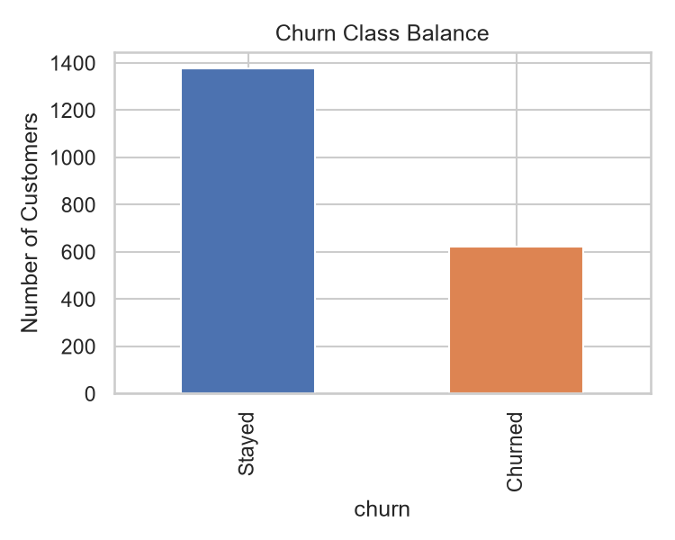
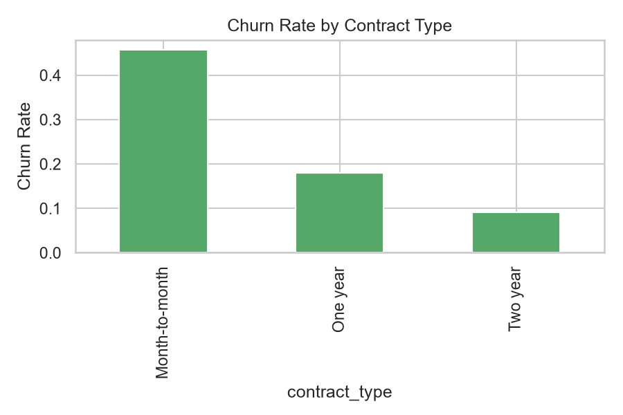
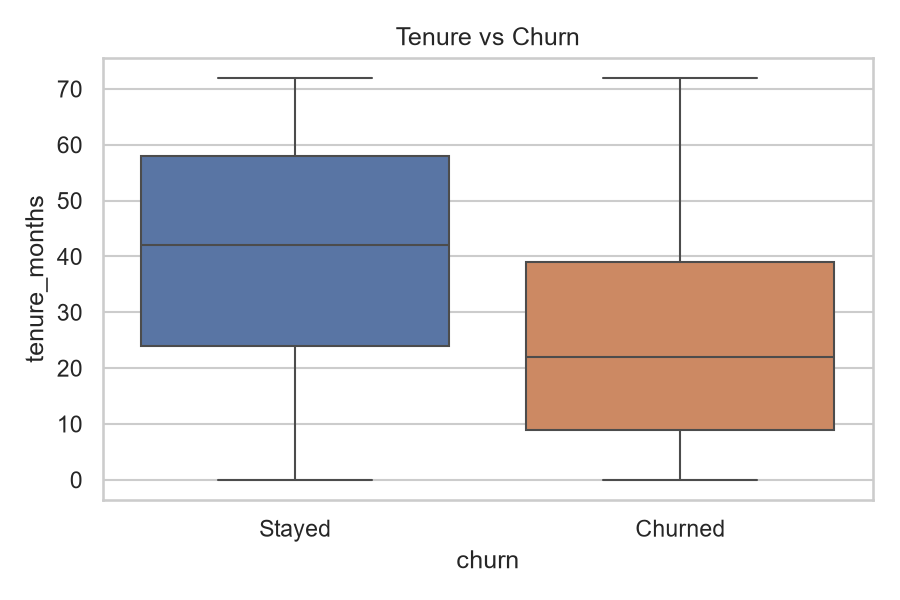
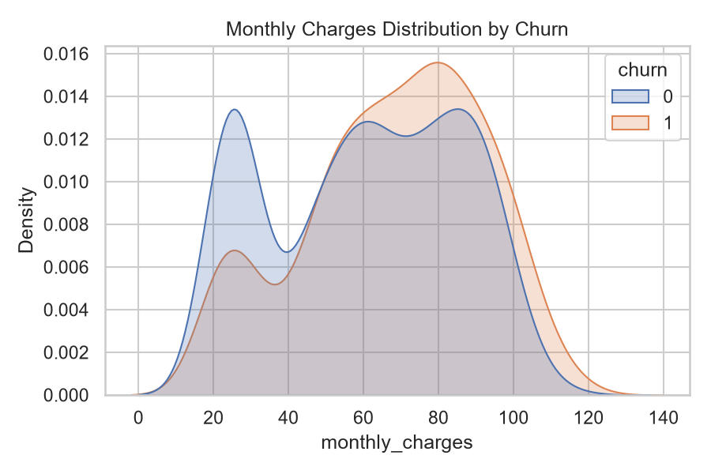
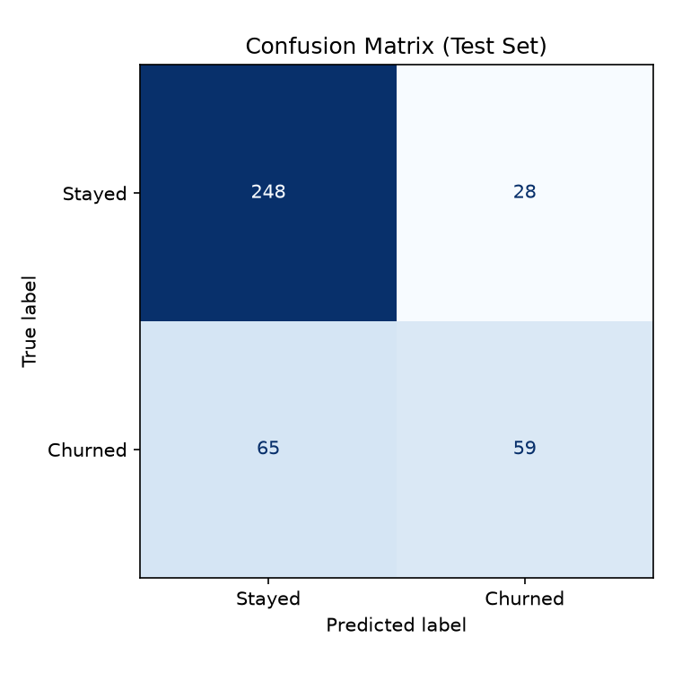
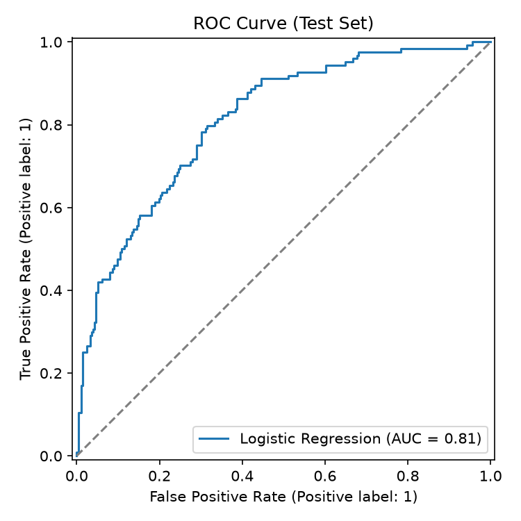

# Customer Churn Prediction

An end-to-end machine learning project that predicts whether a telecom customer will churn, built as a portfolio project covering the full data science workflow: data generation, EDA, preprocessing, model comparison, evaluation, and deployment-ready inference.

## Why a synthetic dataset?

Public churn datasets (e.g. IBM Telco) require a network download at run time, which makes a project non-reproducible in offline or sandboxed environments. Instead, [`src/data.py`](src/data.py) generates a **realistic synthetic customer base**: 2,000 customers with correlated features (tenure, contract type, monthly charges, support calls, etc.) and a churn label sampled from a logistic function of those features plus noise. This keeps the project fully reproducible while still giving models real, learnable signal and class imbalance (~31% churn rate) to work with.

## Project structure

```
churn-prediction-ml/
├── src/
│   ├── data.py           # Synthetic dataset generator
│   ├── preprocessing.py  # Feature/target split + sklearn ColumnTransformer pipeline
│   ├── eda.py             # Exploratory analysis, saves figures to reports/figures/
│   ├── train.py           # Trains & cross-validates 3 candidate models, saves the best
│   ├── evaluate.py        # Test-set evaluation: confusion matrix, ROC curve, feature importance
│   └── predict.py         # CLI for scoring new customer CSVs with the saved model
├── tests/
│   └── test_pipeline.py   # pytest suite covering data generation & the training pipeline
├── data/churn_data.csv    # Generated dataset (committed for reproducibility)
├── models/best_model.joblib
├── reports/
│   ├── figures/           # EDA + evaluation plots
│   └── model_comparison.json
└── requirements.txt
```

## Setup

```bash
python -m venv .venv
.venv\Scripts\activate        # Windows
source .venv/bin/activate     # macOS/Linux
pip install -r requirements.txt
```

## Usage

```bash
python -m src.data        # generate data/churn_data.csv
python -m src.eda         # generate EDA figures
python -m src.train       # cross-validate models, save the best to models/best_model.joblib
python -m src.evaluate    # evaluate the saved model on the held-out test set
pytest tests/             # run the test suite

# Score new customers (CSV must contain the feature columns from src/preprocessing.py)
python -m src.predict --input new_customers.csv --output predictions.csv
```

## Exploratory data analysis

| Churn class balance | Churn rate by contract type |
|---|---|
|  |  |

| Tenure vs. churn | Monthly charges by churn |
|---|---|
|  |  |

Month-to-month contracts churn at roughly **5x** the rate of two-year contracts, and churned customers skew toward shorter tenure and higher monthly charges — exactly the kind of signal a model should be able to pick up on.

## Modeling

Three models were trained and compared with 5-fold stratified cross-validation on the training split (80/20 train/test):

| Model | Accuracy | Precision | Recall | F1 | ROC-AUC |
|---|---|---|---|---|---|
| **Logistic Regression** | 0.771 | 0.665 | 0.536 | 0.593 | **0.826** |
| Gradient Boosting | 0.771 | 0.673 | 0.516 | 0.583 | 0.810 |
| Random Forest | 0.756 | 0.641 | 0.492 | 0.556 | 0.793 |

**Logistic Regression** was selected as the best model (highest CV ROC-AUC) and evaluated on the held-out test set:

- **Test ROC-AUC: 0.812**
- **Test accuracy: 76.8%**

| Confusion matrix | ROC curve |
|---|---|
|  |  |

Full metrics are in [`reports/model_comparison.json`](reports/model_comparison.json).

## Possible extensions

- Hyperparameter tuning (`GridSearchCV`/`RandomizedSearchCV`) for the gradient boosting and random forest models
- SHAP values for per-customer explanations instead of global feature importance
- A small Streamlit app wrapping `src/predict.py` for interactive scoring
- Swap in a real dataset (e.g. IBM Telco Customer Churn) once network access is available — the pipeline is dataset-agnostic as long as column names match `src/preprocessing.py`
