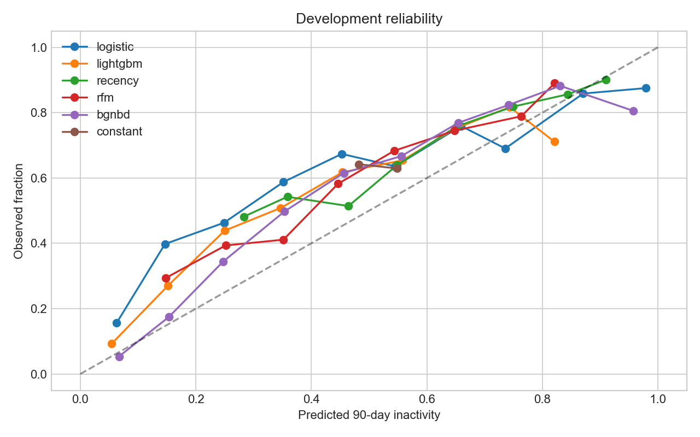
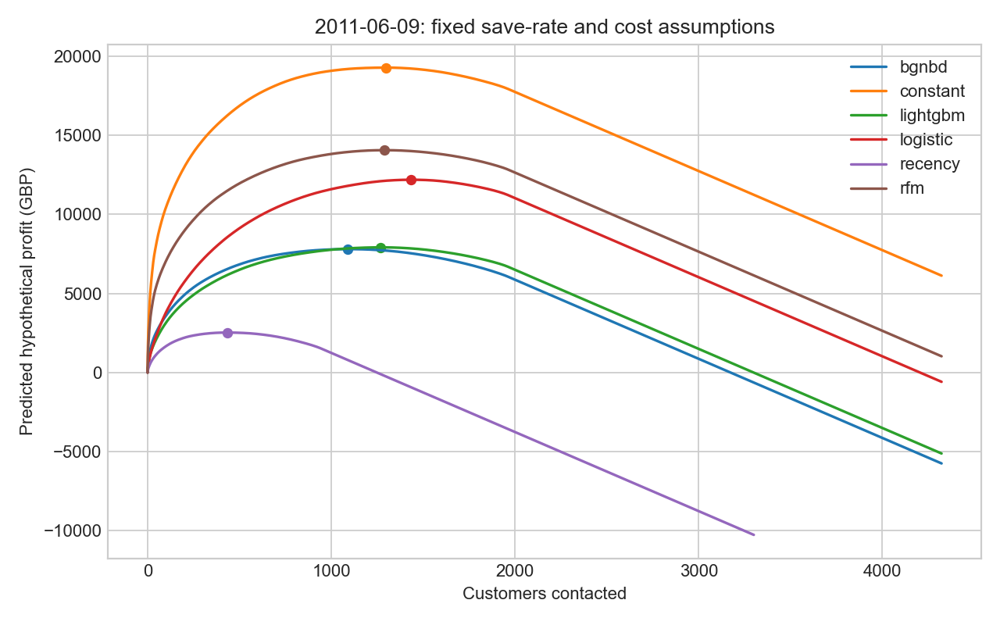
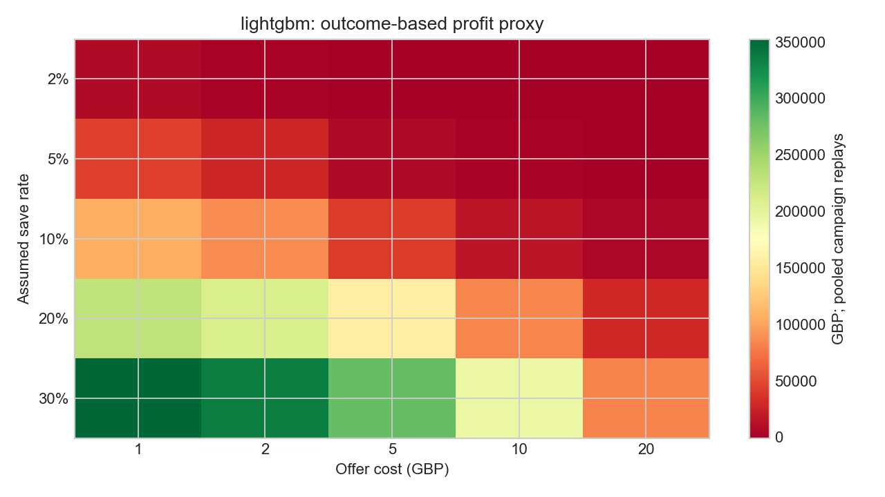
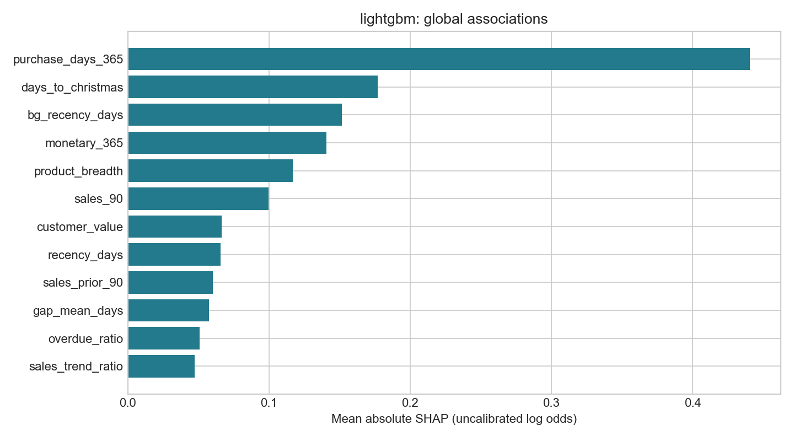

# churn-prediction-ml

**ML superiority not established: lightgbm versus bgnbd, development profit-proxy difference GBP -7,316.42 (95% CI -8,413.80 to -6,322.93).**

Development results only; the holdout remains sealed. The reported values are hypothetical retention policy values, not measured
treatment profit. The simple customer-base model is a serious comparator; an ML
win is not assumed. Non-significance does not prove equivalence.

## Why the old project was circular

The original generated customer labels from a hand-written logistic formula, then
trained models to rediscover it. The winning model and contract-risk insight were
built into the data generator. That version is preserved as `v0-synthetic`.

## Real data, reconciled

[UCI Online Retail II](https://doi.org/10.24432/C5CG6D) supplies
1,067,371 invoice lines. The identified sales population contains
5,852 customers and 36,594 invoices.
Each raw row appears exactly once in this cleaning waterfall; the final row is retained.

| Disposition | Rows | Exact signed GBP |
|---|---:|---:|
| sheet_overlap | 22,523 | 377488.450 |
| exact_duplicate | 11,812 | 54228.420 |
| bad_debt_adjustment | 6 | -147614.080 |
| non_product | 5,795 | 75748.711 |
| cancellation | 17,915 | -716462.570 |
| stock_adjustment | 5,963 | 0.000 |
| missing_customer | 226,761 | 2575278.900 |
| sale | 776,596 | 17068582.737 |

Missing IDs remove GBP 2575278.900 of otherwise
valid gross product sales. Cancellations are retained separately for historical
features; they are never counted as purchases. Source prices retain their precision:
17 lines worth GBP
0.017 would become zero-price rows
if rounded to pennies first. [Rules and provenance](docs/DATA.md).

## Evaluation fixed before modelling

[Preregistration](docs/PREREGISTRATION.md) defines monthly midnight cutoffs on the
ninth, a trailing-year eligible population, and zero purchases in the following
90 days as the label. Features use only transactions at or before the cutoff.
Deleting all future sales and cancellations left all features identical at every
development cutoff. Category breadth is a fixed keyword proxy, not a genuine taxonomy.

There are 13 development cutoffs and
8 evaluated rolling origins.
Training labels must mature before each validation/test cutoff, including inner CV
and calibration. Hyperparameters, Platt/isotonic calibration and recency thresholds
are selected on training history only. The final models use only development
labels matured before the first held-out cutoff; no earlier holdout month trains a later one.

The registered held-out dates are 2011-07-09, 2011-08-09, 2011-09-09.
The guard rejects access outside the one-use audited session. It is a procedural
evaluation seal over public data, not protection against deliberate source-code edits.

| Development cutoff | Eligible customers | Churn base rate |
|---|---:|---:|
| 2010-11-09 | 3,996 | 0.576827 |
| 2010-12-09 | 4,229 | 0.686214 |
| 2011-01-09 | 4,210 | 0.656057 |
| 2011-02-09 | 4,240 | 0.645991 |
| 2011-03-09 | 4,274 | 0.633131 |
| 2011-04-09 | 4,329 | 0.625087 |
| 2011-05-09 | 4,326 | 0.618816 |
| 2011-06-09 | 4,322 | 0.639287 |

## Models versus baselines

PR-AUC means average precision. Profit brackets are customer-bootstrap 95% CIs;
all per-cutoff and pooled metric CIs are in [the result file](results/development_evaluation.json).

| Method | PR-AUC | ROC-AUC | Brier | Profit proxy GBP [95% CI] |
|---|---:|---:|---:|---:|
| bgnbd | 0.817 | 0.757 | 0.194 | 49,282.07 [43,673.03, 55,275.87] |
| constant | 0.631 | 0.487 | 0.248 | 44,856.58 [38,895.65, 51,062.88] |
| lightgbm | 0.788 | 0.718 | 0.211 | 41,965.65 [36,418.21, 47,887.18] |
| logistic | 0.761 | 0.673 | 0.227 | 39,802.04 [34,334.47, 45,636.53] |
| recency | 0.768 | 0.659 | 0.223 | 26,219.70 [22,767.50, 29,887.56] |
| rfm | 0.786 | 0.712 | 0.209 | 42,021.59 [36,361.61, 47,807.44] |

The selected ML candidate is **lightgbm**. Paired comparisons use the same sampled
customers across methods; every sampled customer carries all their cutoff rows.
There are 2,000 bootstrap draws. The three baseline comparisons
also receive a familywise-95% correction. Every adjusted lower bound must exceed
zero to establish the preregistered ML superiority claim.

| Baseline | ML minus baseline GBP | Paired 95% CI | Familywise-95% interval |
|---|---:|---:|---:|
| recency | 15,745.95 | [12,748.03, 18,987.77] | [12,060.62, 19,785.12] |
| rfm | -55.94 | [-931.31, 860.34] | [-1,088.83, 1,109.70] |
| bgnbd | -7,316.42 | [-8,413.80, -6,322.93] | [-8,666.77, -6,158.16] |

| Method | Precision top 10% [CI] | Lift top 10% [CI] | Precision top 20% [CI] | Lift top 20% [CI] |
|---|---:|---:|---:|---:|
| bgnbd | 0.881 [0.865, 0.896] | 1.386 [1.353, 1.417] | 0.878 [0.866, 0.890] | 1.382 [1.355, 1.408] |
| constant | 0.601 [0.567, 0.639] | 0.946 [0.895, 1.001] | 0.616 [0.591, 0.641] | 0.969 [0.934, 1.004] |
| lightgbm | 0.859 [0.842, 0.876] | 1.352 [1.320, 1.383] | 0.852 [0.840, 0.865] | 1.341 [1.317, 1.367] |
| logistic | 0.869 [0.853, 0.884] | 1.367 [1.336, 1.398] | 0.863 [0.852, 0.875] | 1.358 [1.332, 1.384] |
| recency | 0.821 [0.803, 0.838] | 1.291 [1.259, 1.324] | 0.822 [0.808, 0.834] | 1.293 [1.267, 1.317] |
| rfm | 0.867 [0.850, 0.883] | 1.365 [1.334, 1.395] | 0.861 [0.848, 0.873] | 1.355 [1.329, 1.379] |



BG/NBD uses a verified conditional probability of zero purchases in the prediction
window. Probability alive is also retained in local predictions; it is not
interchangeable with that churn probability. All methods share the same value proxy.
Every candidate, calibration attempt, optimizer warning and failed fit is retained
in [the trial ledger](docs/TRIALS.md). Development model selection is optimistic.

## Who gets an offer?

Assumptions: save rate 10%, cost GBP
5 per contact, and margin 30% of
trailing 90-day sales net of observed product cancellations,
floored at zero. Rank by `P(churn) × save_rate × value − offer_cost`; choose the
profit-maximizing prefix, allowing no contacts. Risk-ranking metrics are separate
from value-aware contact selection. Do not select contacts using test outcomes.

For evaluation, freeze the contacts and replace predicted churn with observed
churn in the payoff calculation. Comparing models' own predicted profits would
reward overconfidence. This outcome-based profit proxy is still conditional on
assumed retention effectiveness, not measured uplift.




The full [sensitivity grid](results/development_sensitivity.json) varies save rate and
offer cost for every method. It cannot replace the preregistered primary cell.

## Placebo and explanations

The single within-cutoff label shuffle produced lightgbm PR-AUC
0.627 [0.620, 0.634], versus a base rate of 0.636.
Top-decile lift was 1.017 [0.993, 1.040]; the predictive advantage vanished.
Its profit-proxy difference versus constant risk was GBP -253.61
(95% CI -475.90 to -50.09).
The placebo was not repeatedly reshuffled to obtain a desired answer.



SHAP explains uncalibrated model log odds with training-only background information.
It describes associations, not causes or offer responsiveness. Local per-customer
reasons appear in the Streamlit app, alongside risk, value and contact decisions.

## Limits that matter

- Historical UK gift wholesaler, many B2B buyers, strong seasonality and Christmas
  effects. A nonpurchase window is not permanent churn or a subscription cancellation.
- Anonymous buyers are excluded. Acquisition before the source begins is unknown.
  Exact repeated lines may include genuine purchases; cancellations lack original-order links.
- Billing reversals and extreme orders can distort trailing value. Margin and
  save rate are assumptions. **There are no treatment data; real uplift is unknown.**
- Monthly windows overlap. Pooled profits are sums of independent campaign replays,
  not an additive quarterly cash forecast. Repeated-offer fatigue is unmeasured.
- Customer bootstrap uncertainty does not cover regime shifts, new retailers,
  treatment effectiveness or development-selection optimism. Use a randomized
  retention trial before deploying any contact policy.

## Reproduce and explore

```powershell
py -3.11 -m venv .venv
.venv/Scripts/python.exe -m pip install -c requirements-lock.txt -e '.[dev]'
.venv/Scripts/python.exe -m churn run-all
.venv/Scripts/python.exe -m pytest -q
.venv/Scripts/python.exe -m ruff check .
.venv/Scripts/python.exe -m streamlit run app/streamlit_app.py
```

`run-all` builds missing development artifacts and reports. Once the holdout receipt
exists, it preserves the recorded one-time evaluation and refuses another unsealing.
Frozen model binaries and customer-level data are local, ignored artifacts; retain
them to reproduce the exact released app and holdout figures. A fresh clone can
rebuild development results, but cannot recover ignored holdout artifacts from Git.
The committed freeze manifests, aggregate results and receipt remain auditable.
The app reads results only; sliders never retrain models or open the seal.

CI runs lint, dependency checks and fixture tests without downloading UCI data.
The README and model card are generated from result files and tested for exact agreement.
See [model card](docs/MODEL_CARD.md). The freeze manifest and holdout
receipt are written when the holdout is opened (`python -m churn holdout`). No data or model binaries are committed.

Code: [MIT](LICENSE). Data: UCI CC BY 4.0.
